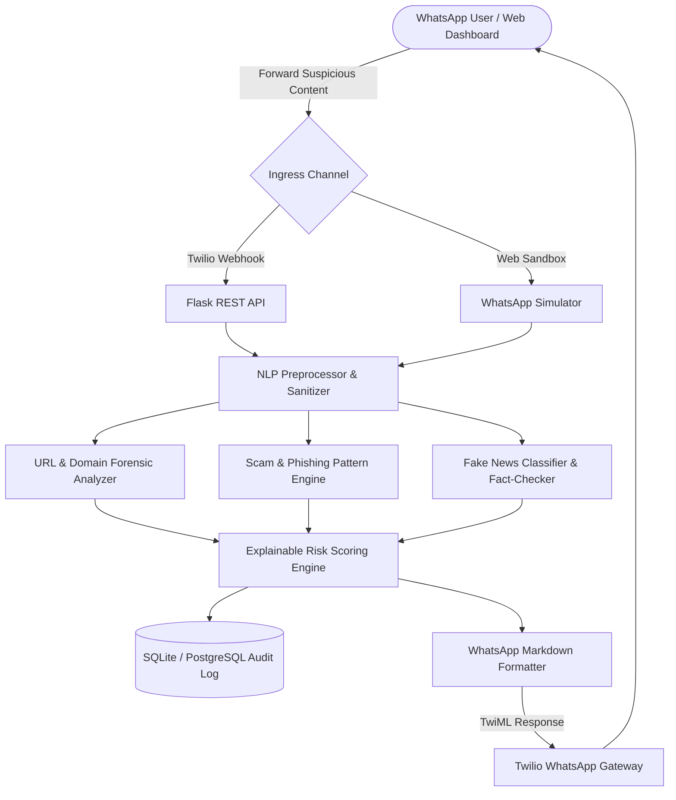

# 🛡️ ScamShield AI — AI-Powered Fake News and Online Scam Detection WhatsApp Chatbot

ScamShield AI is an end-to-end, privacy-preserving cybersecurity intelligence platform and WhatsApp chatbot. It empowers users to forward suspicious text messages, viral claims, job offers, lottery notifications, and phishing URLs to an automated AI bot for real-time risk assessment, explainable indicators, and safety advice.

---

## 🌟 Key Features

1. **WhatsApp Chatbot Integration**:
   - Inbound Twilio WhatsApp Webhook (`/api/webhook/whatsapp`) with cryptographic signature validation (`X-Twilio-Signature`).
   - Clean, structured markdown responses with estimated risk scores, warning bullet points, link security checks, and actionable safety steps.
   - Built-in **WhatsApp Web Simulator** in the dashboard to test the chatbot live without requiring Twilio credentials.

2. **Explainable Risk Scoring Engine (0 to 100)**:
   - **Low Risk (0–24)**: Likely safe communication.
   - **Caution (25–49)**: Unverified claims or unfamiliar links requiring care.
   - **Suspicious (50–74)**: Multiple red flags, questionable domains, or manipulative urgency.
   - **High Risk (75–100)**: High-risk phishing, confirmed scams, or dangerous viral misinformation.

3. **Separate Detection Logic**:
   - **Fake News & Misinformation**: TF-IDF + Logistic Regression classifier (80.0% accuracy, 0.8333 F1 score) coupled with an accredited fact-checking cross-reference knowledge base (PIB Fact Check, BoomLive, AltNews, Snopes, WHO).
   - **Scams & Phishing**: Evaluates KYC account suspensions, OTP credential harvesters, Kaun Banega Crorepati/lottery scams, YouTube rating task scams, crypto doubling schemes, and courier impersonations.

4. **URL & Domain Forensic Analyzer**:
   - Detects raw IP addresses as hosts (e.g., `http://192.168.1.1`).
   - Identifies URL shorteners (`bit.ly`, `tinyurl.com`, `is.gd`) concealing destination domains.
   - Flags suspicious high-abuse TLDs (`.top`, `.xyz`, `.buzz`, `.cc`, `.pw`).
   - Brand spoofing and typosquatting detection for major banks and services (SBI, HDFC, ICICI, Amazon, FedEx).

5. **Privacy by Design**:
   - **Zero Plaintext Phone Numbers**: Sender numbers are salted and hashed via SHA-256.
   - **PIB/Sensitive Data Masking**: Phone numbers, cards, and account numbers are redacted in database audit logs.
   - Configurable data retention policies.

---

## 🏗️ Architecture



---

## 🛠️ Technology Stack

| Layer | Technologies |
|---|---|
| **Backend API** | Python 3.12+, Flask 3.1, Blueprints, Application Factory Pattern |
| **Database & ORM** | SQLAlchemy 2.1, SQLite (Local Dev) / PostgreSQL (Production) |
| **AI / NLP** | scikit-learn 1.9, TF-IDF Vectorization, Logistic Regression, NLTK-style regex tokenization |
| **Fact-Checking** | Google ClaimReview API integration & Curated Debunking Knowledge Base |
| **WhatsApp Gateway** | Twilio REST API, Twilio RequestValidator, TwiML MessagingResponse |
| **Frontend** | React 19, Vite 8, Recharts, Lucide Icons, Cyberpunk Dark CSS Tokens |

---

## 📁 Project Structure

```
scamshield-ai/
├── backend/
│   ├── app/
│   │   ├── __init__.py               # Flask application factory with demo data seeder
│   │   ├── config.py                 # Dev / Testing / Prod environment configs
│   │   ├── extensions.py             # db (SQLAlchemy), cors
│   │   ├── models/
│   │   │   ├── scan_record.py        # Privacy-preserving scan audit model
│   │   │   ├── domain_reputation.py  # Domain reputation cache
│   │   │   └── fact_check_item.py    # Accredited fact-check debunks
│   │   ├── api/
│   │   │   ├── analyze.py            # POST /api/analyze (Interactive scanner)
│   │   │   ├── webhook.py            # POST /api/webhook/whatsapp & /api/webhook/simulate
│   │   │   ├── stats.py              # GET /api/stats (Telemetry for charts)
│   │   │   ├── history.py            # GET /api/history (Paginated audit logs)
│   │   │   └── rules.py              # GET /api/rules (Rule definitions & ML metrics)
│   │   └── services/
│   │       ├── nlp_preprocessor.py   # Tokenizer, URL extractor, PII masking, SHA-256 hasher
│   │       ├── url_analyzer.py       # Domain reputation, TLD checks, IP URLs, brand spoofing
│   │       ├── scam_detector.py      # Rule-based scam patterns & ML scam classifier
│   │       ├── fake_news_detector.py # ML news classifier & fact-check cross-referencing
│   │       ├── fact_checker.py       # Fact check interface & curated archive
│   │       ├── risk_engine.py        # Multi-factor explainable 0-100 risk scoring
│   │       └── twilio_service.py     # Twilio signature validation & WhatsApp markdown builder
│   ├── data/
│   │   ├── fake_news_dataset.json    # Labeled dataset of genuine news vs viral hoaxes
│   │   ├── scam_dataset.json         # Labeled dataset of safe messages vs scams
│   │   ├── scam_patterns.json        # Categorized scam indicators, regexes, and advice
│   │   ├── train_models.py           # Training & evaluation script
│   │   └── models/
│   │       ├── fake_news_model.pkl   # Serialized fake news classifier
│   │       ├── scam_model.pkl        # Serialized scam classifier
│   │       └── model_metrics.json    # Evaluation metrics (Accuracy, F1, Confusion Matrix)
│   ├── tests/
│   │   ├── test_nlp.py               # NLP & PII masking unit tests
│   │   ├── test_url_analyzer.py      # Domain & URL security unit tests
│   │   ├── test_risk_engine.py       # Risk scoring engine unit tests
│   │   └── test_api.py               # REST API & webhook unit tests
│   ├── run.py                        # Backend server entrypoint
│   ├── requirements.txt              # Python dependencies
│   └── .env                          # Local environment settings
├── frontend/
│   ├── src/
│   │   ├── components/
│   │   │   ├── Navbar.jsx            # Header & system navigation
│   │   │   ├── StatCards.jsx         # Live telemetry cards
│   │   │   ├── LiveScanner.jsx       # Interactive message scanner with sample presets
│   │   │   ├── WhatsAppSimulator.jsx # Interactive WhatsApp Web chat emulator
│   │   │   ├── AnalyticsView.jsx     # Recharts charts (Severity, Categories, Timeline)
│   │   │   ├── RecentScansTable.jsx  # Audit log data table with forensic inspection modal
│   │   │   ├── ModelMetricsView.jsx  # AI/ML evaluation metrics & confusion matrix
│   │   │   └── TwilioGuideView.jsx   # Twilio sandbox setup guide
│   │   ├── utils/
│   │   │   └── api.js                # Frontend API wrapper
│   │   ├── App.jsx                   # Main layout container
│   │   └── index.css                 # Cybersecurity dark theme design system
│   ├── package.json
│   └── vite.config.js
├── start.bat                         # One-click startup script for Windows
└── README.md
```

---

## 🚀 Quick Start Guide

### 1. Prerequisites
- Python 3.12+
- Node.js v18+ & npm

### 2. Backend Setup
```bash
cd backend
python -m pip install -r requirements.txt
python data/train_models.py
python run.py
```
Backend runs at: `http://127.0.0.1:5000`

### 3. Frontend Setup
```bash
cd frontend
npm install
npm run dev
```
Dashboard runs at: `http://localhost:5173`

Or run `start.bat` on Windows to launch both services simultaneously.

---

## 🧪 Automated Testing

Run the full Python test suite:
```bash
cd backend
python -m unittest discover tests
```
All 17 unit tests validate:
- URL extraction & IP address detection
- PII masking and SHA-256 user identifier hashing
- Lottery, KYC, task scam, and fake news risk calculations
- REST API `/api/analyze`, `/api/stats`, `/api/history`, and `/api/webhook/simulate` endpoints

---

## 📱 Twilio WhatsApp Sandbox Setup

1. Open your **Twilio Console** and navigate to **Messaging > Try WhatsApp > WhatsApp Sandbox**.
2. Send the sandbox join message (e.g., `join <your-code>`) to **+1 415 523 8886** from your WhatsApp app.
3. Expose your local Flask server using ngrok:
   ```bash
   ngrok http 5000
   ```
4. In Twilio Sandbox Settings, set the **"When a message comes in"** URL to:
   ```
   https://<your-ngrok-url>/api/webhook/whatsapp
   ```
   with HTTP method: `POST`.
5. Forward any suspicious message to the Twilio number to receive instant automated analysis!

---

## ⚖️ Disclaimer

ScamShield AI provides **automated algorithmic risk assessments** based on linguistic pattern analysis, machine learning heuristics, and cross-referenced public fact-checking records. It does not provide legal findings or absolute guarantees. Users should always exercise independent caution before sharing credentials, clicking links, or forwarding unsolicited claims.
